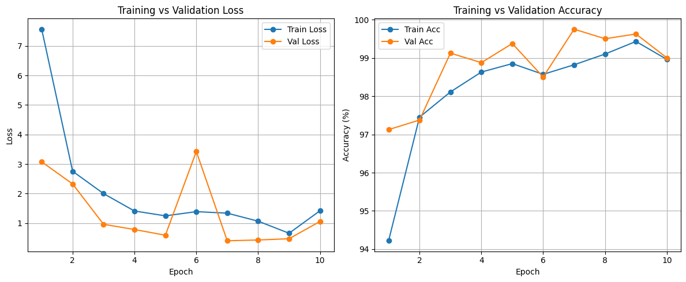

# Face Mask Detection

A real-time face mask detector using a PyTorch CNN and OpenCV. The application
reads frames from your webcam, detects faces with a Haar cascade, classifies
each face as **WithMask** or **WithoutMask**, and displays the prediction.

## Project structure

```text
FaceMaskDetection/
├── model/
│   └── face_mask_cnn.pth
├── notebooks/
│   └── faceMaskTrainCNN.ipynb
├── src/
│   ├── detector.py
│   ├── faceDetector.py
│   └── model.py
└── requirements.txt
```

## Requirements

- Windows, macOS, or Linux with a working webcam
- Python 3.10 or newer
- The trained checkpoint at `model/face_mask_cnn.pth`

The project uses OpenCV's GUI-enabled package because the detector displays a
live preview window. Do not replace `opencv-python` with
`opencv-python-headless` when running the webcam application.

## Installation

Open a terminal in the project root and create a virtual environment:

```powershell
py -m venv .venv
.\.venv\Scripts\Activate.ps1
python -m pip install --upgrade pip
pip install -r requirements.txt
```

If PowerShell blocks virtual environment activation, run the Python executable
directly instead:

```powershell
.\.venv\Scripts\python.exe -m pip install -r requirements.txt
```

## Run the detector

From the project root:

```powershell
python .\src\detector.py
```

The application uses webcam device `0`. Press **Q** while the preview window is
focused to stop detection and close the camera.

The model checkpoint is loaded from `model/face_mask_cnn.pth`. For compatibility
with an older local checkpoint, `model/mask_detector.pth` is also accepted.
The application selects CUDA when available and otherwise runs on the CPU.

## Training

The training notebook is `notebooks/faceMaskTrainCNN.ipynb`. It documents the
CNN training and validation process and saves the trained weights as
`face_mask_cnn.pth`. Place the checkpoint in the repository's `model/`
directory before running the webcam detector.

### Training graphs

The graphs below use the 10-epoch metrics recorded in the training notebook.
The notebook reports **98.79% test accuracy** on its 992-image test set.



| Epoch | Training accuracy | Validation accuracy |
| ---: | ---: | ---: |
| 1 | 94.22% | 97.12% |
| 2 | 97.45% | 97.38% |
| 3 | 98.11% | 99.12% |
| 4 | 98.63% | 98.88% |
| 5 | 98.85% | 99.38% |
| 6 | 98.57% | 98.50% |
| 7 | 98.82% | 99.75% |
| 8 | 99.10% | 99.50% |
| 9 | 99.43% | 99.62% |
| 10 | 98.96% | 99.00% |

The detector expects 224 x 224 RGB face crops and applies the same ImageNet
normalization used in the training notebook:

```text
mean = [0.485, 0.456, 0.406]
std  = [0.229, 0.224, 0.225]
```

The class mapping used by the training notebook is:

| Output index | Class |
| --- | --- |
| 0 | WithMask |
| 1 | WithoutMask |

## Troubleshooting

- **Could not open webcam:** Close other applications using the camera, check
  operating-system camera permissions, and confirm that the webcam is connected.
- **Could not read webcam frame:** Check that the webcam is enabled and
  functioning, then restart the application.
- **`cv2.imshow` is not implemented:** Install the requirements in the same
  Python environment used to run the application. The GUI-enabled
  `opencv-python` package is required.
- **Model not found:** Verify that `model/face_mask_cnn.pth` exists, or place
  the older checkpoint at `model/mask_detector.pth`.
- **Predictions appear inaccurate:** Ensure the checkpoint was trained with the
  class mapping and preprocessing documented above, use good lighting, and keep
  your face clearly visible to the webcam. Confidence is the model's estimated
  probability, not a guarantee of correctness.